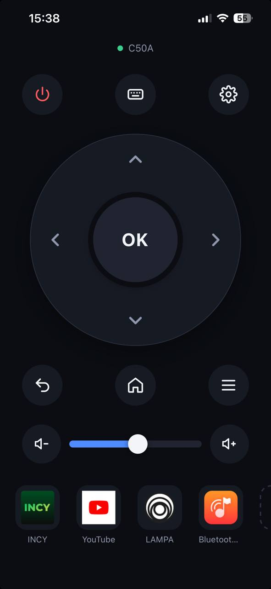

# Web TV Remote

[English version](README.md)

Превратите любой телефон, планшет или компьютер в пульт для Android-приставки или проектора. На
телефон ничего ставить не нужно: откройте ссылку в браузере, введите PIN с экрана ТВ — и готово.

  

- Работает на Android-приставках и проекторах с Android 11 или новее.
- Пользоваться пультом могут сразу несколько телефонов в домашнем Wi-Fi.
- Запускается сам, когда включается приставка или проектор.
- Его можно добавить на экран «Домой» телефона, и он будет открываться как обычное приложение.

## Установка

1. Установите `web-tv-remote.apk` из [Releases](../../releases).
2. Один раз откройте **Web TV Remote** на приставке. После этого он будет запускаться сам при каждом
   включении приставки.

### Разблокировать все кнопки (рекомендуется)

По умолчанию Android не разрешает приложению нажимать кнопки за вас, поэтому без этого шага работают
только «Назад», «Домой», громкость, клавиатура и ярлыки приложений. Чтобы заработали крестовина, «OK»
и все остальные кнопки, один раз включите «Отладку по сети»:

1. На приставке: **Настройки → Настройки устройства → Об устройстве**, затем нажмите **Сборка** семь
   раз, пока не появится сообщение «Вы стали разработчиком».
2. Вернитесь в **Настройки устройства → Для разработчиков** и включите **Отладку по USB** и
   **Отладку по сети** (на некоторых приставках она называется **ADB по сети**).
   Кнопка **Для разработчиков** в Web TV Remote сама открывает этот экран.
3. Снова откройте Web TV Remote. Появится окно **«Разрешить отладку?»**: отметьте
   **«Всегда разрешать с этого компьютера»** и нажмите **OK** родным пультом приставки.

Теперь на экране ТВ написано **«Управление: полное, через ADB»**. Это нужно сделать только один раз.

Это разрешение использует только Web TV Remote на самой приставке; компьютер не участвует, и ничего
не уходит за пределы домашней сети.

## Подключите телефон

1. Откройте Web TV Remote на приставке. Справа будет ссылка вида `http://living-room.local:8080`
   и QR-код.
2. Отсканируйте QR-код камерой телефона или введите ссылку в браузере телефона.
   Телефон должен быть в том же Wi-Fi, что и приставка.
3. На ТВ появится 4-значный PIN. Введите его на телефоне.

Телефон запоминается, поэтому PIN спрашивается только один раз. Чтобы отключить все телефоны,
нажмите **Забыть устройства** в Web TV Remote на приставке.

В ссылке используется имя приставки (из **Настройки → Настройки устройства → Об устройстве →
Название устройства**), поэтому она продолжает работать, даже если роутер выдаст приставке новый
IP-адрес. Сохраните её в закладки.

## Добавить на экран «Домой»

- **iPhone / iPad (Safari):** Поделиться → **На экран «Домой»**. Пульт будет открываться на весь экран.
- **Android (Chrome):** ⋮ → **Добавить на главный экран**. Он откроется с адресной строкой браузера —
  так Chrome обращается с сайтами в домашней сети.

## Решение проблем

**На телефоне написано «Ограниченный режим», и крестовина не работает.**
Отладка по сети выключена или не была разрешена. Выполните шаги из раздела
[Разблокировать все кнопки](#разблокировать-все-кнопки-рекомендуется).
Если на ТВ написано *подтвердите «Разрешить отладку»*, найдите это окно на ТВ и подтвердите его
родным пультом приставки.

**Нет пункта «Отладка по сети».**
На некоторых приставках есть только *Беспроводная отладка* с кодом сопряжения, она пока не
поддерживается. Но отладку по сети можно один раз включить с компьютера:
подключите приставку по USB и выполните `adb tcpip 5555`. На некоторых приставках это приходится
повторять после каждой перезагрузки.

**Ссылка из QR-кода не открывается на Android-телефоне.**
Некоторые Android-телефоны не понимают имена `.local`. Найдите IP-адрес приставки в списке устройств
роутера и откройте вместо этого `http://<IP-адрес>:8080`. Чтобы адрес не менялся, закрепите за
приставкой постоянный IP в роутере.

**На странице написано «ТВ недоступен».**
Проверьте, что телефон и приставка в одной Wi-Fi-сети и что приставка включена, а не в спящем режиме.

**Пульт не работает после включения приставки.**
Один раз откройте Web TV Remote на приставке — Android не запускает приложение автоматически, пока
его хотя бы раз не открыли. На медленных приставках подождите около минуты после включения.

**Не вижу PIN на ТВ.**
Откройте Web TV Remote на приставке: PIN показывается и там. Если он истёк, нажмите на телефоне
**Показать PIN ещё раз**.

## Ограничения

- Пульт не может включить выключенную приставку или проектор, потому что сам работает на приставке.
  **Питание** только переводит приставку в сон. Повторное нажатие разбудит её, только если во сне она
  остаётся в Wi-Fi, а многие приставки во сне Wi-Fi выключают.
- Телефон и приставка должны быть в одной домашней сети; через интернет пульт не работает.
- Некоторые приложения, которые принимают только свой пульт, могут игнорировать часть кнопок.
- В приложениях со своей экранной клавиатурой (вместо обычного поля ввода) нелатинский текст
  вставляется, а некоторые приложения это не поддерживают.

## Конфиденциальность

Web TV Remote работает только внутри домашней сети и ничего не отправляет в интернет.
Управлять приставкой может только телефон, на котором ввели PIN с экрана ТВ.

## Для разработчиков

Сборка с JDK 17 и Android SDK 35: `./gradlew assembleRelease`. Веб-пульт — обычные
HTML/CSS/JS в [app/src/main/assets/web](app/src/main/assets/web). Архитектура описана в
[CLAUDE.md](CLAUDE.md).

## Лицензия

[MIT](LICENSE)
